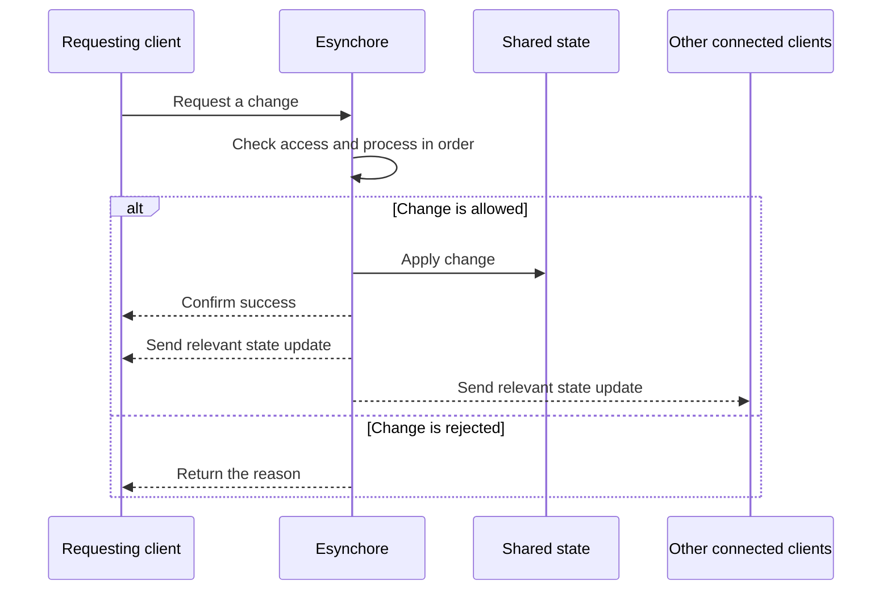

# Esynchore

Synchronous event choreography for shared state

Esynchore helps Dart servers coordinate shared state through authenticated
sessions and ordered commands. Clients submit commands over HTTP and receive
their results directly; WebSockets independently deliver authenticated state
updates and heartbeats.

## Features

- **Core state and sessions** — define authorized state transitions, authenticate
  clients, and manage in-memory sessions with [`esynchore_core`](packages/esynchore_core/README.md).
- **Server adapters** — expose command and state endpoints with
  [`esynchore_backend`](packages/esynchore_backend/README.md) (Shelf) or
  [`esynchore_dart_frog`](packages/esynchore_dart_frog/README.md) (Dart Frog).
- **Command client** — submit HTTP commands from Dart or Flutter using
  [`esynchore_flutter`](packages/esynchore_flutter/README.md).
- **Principal-specific views** — project state for each authenticated client;
  command failures are returned to the caller as HTTP responses.

## Standard flow



## Client-server example

On the server, create a session service and mount its command and WebSocket
handlers at `/commands` and `/state`. Supply application-specific serializers
and authentication:

```dart
final sessions = StateSessionService<AppState, Token, Principal>(
  authenticate: authenticate,
)..create("main", initialState);

final commands = sessionCommandHandler(
  sessions: sessions,
  id: "main",
  commandSerializer: commandSerializer,
  readCredentials: (request) => request.headers["authorization"] ?? "",
);
final state = sessionWebSocketHandler(
  sessions: sessions,
  id: "main",
  credentialsSerializer: credentialsSerializer,
  stateSerializer: stateSerializer,
  projectState: (state, principal) => projectFor(state, principal),
);
```

The client sends a command over HTTP; expected failures are returned as
`ErrorMessage` values:

```dart
final client = HttpCommandClient<Token, AppCommand>(
  endpoint: Uri.parse("http://localhost:8080/commands"),
  commandSerializer: commandSerializer,
  headersForCredentials: (token) => {"authorization": token},
);

final result = await client.submit(const Increment(), token);
```

See the [counter examples](examples/README.md) for runnable Shelf and Dart Frog
servers and command clients. `ProtocolClient` from `esynchore_core` can be used
to connect to the WebSocket endpoint.

## Contributing

Bug reports and feature requests are welcome in the
[issue tracker](https://github.com/Iconica-Development/dart_esynchore/issues).
Pull requests are welcome; please include or update tests for behavior changes.
Before submitting, run `flutter pub get`, format your changes with
`dart format .`, and run the relevant package's `flutter analyze` and tests.

## Error codes

Framework-defined errors are listed in `EsynchoreErrorCodes.all` and described
by `EsynchoreErrorCodes.descriptions` in `esynchore_core`. Use
`EsynchoreErrorCodes.describe(code)` to look up a description. Applications may
also define their own error codes.